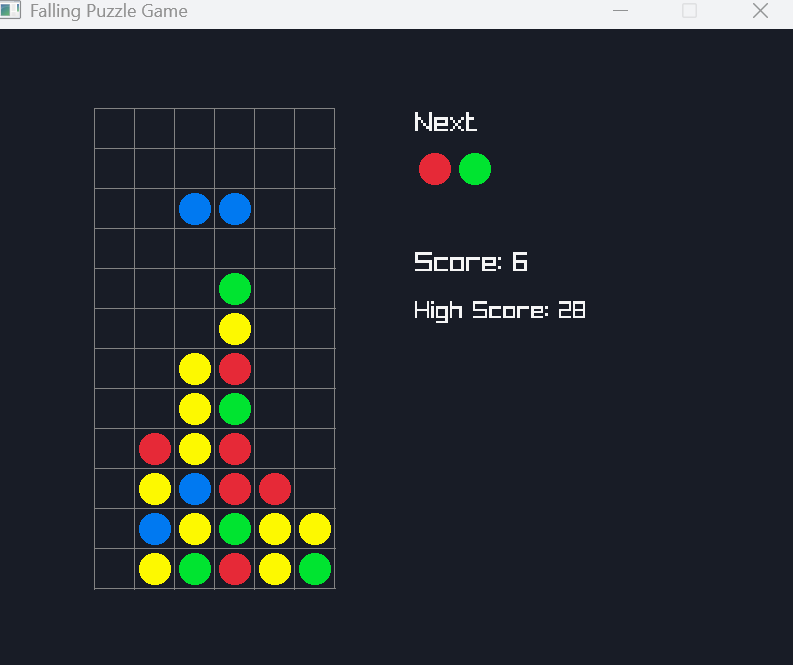
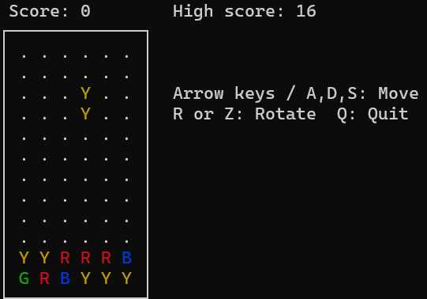

# Falling Puzzle Game

[](https://github.com/lokaro0/falling-puzzle-game/actions/workflows/ci.yml)

同色のブロックを4個以上つなげて消す落ちものパズルゲームです。C++17を使用しており、Windows向けのraylib GUI版と、Linux／WSL向けのncurses版があります。

## Windows GUI版（プレイ可能なプレビュー版）



現在の公開版は[v0.3.0-preview](https://github.com/lokaro0/falling-puzzle-game/releases/tag/v0.3.0-preview)です。タイトルからプレイ、結果表示、再挑戦まで遊べるようになっており、連鎖・同時消しの得点計算、消滅時の点滅・連鎖表示、効果音、ハイスコア保存を実装しています。

### ダウンロードと起動

1. [Releases](https://github.com/lokaro0/falling-puzzle-game/releases)からWindows版のZIPをダウンロードします。
2. ZIPをすべて展開します。
3. 同梱DLLを実行ファイルと同じフォルダに置いたまま、`falling_puzzle_gui.exe`を起動します。

対応環境はWindows 11 64bitです。

### 操作

| 場面 | キーと動作 |
|---|---|
| メニュー・結果・終了確認 | `↑` / `↓`または`W` / `S`で選択、`Enter`で決定 |
| プレイ中 | `←` / `A`で左、`→` / `D`で右、`↓` / `S`で1段落下 |
| 回転 | `R` / `Z`で時計回りに回転 |
| プレイ中の確認 | `Esc`でタイトル復帰、×で終了の確認。Yesで実行、Noまたは`Esc`で再開 |
| Game Over | 新しいキー入力で結果画面へ進む |

終了確認中はゲームの進行が止まります。結果画面のRetryで再挑戦、Titleでタイトルへ戻れます。

### 記録と現在の制限

ハイスコアは`%LOCALAPPDATA%\FallingPuzzleGame\high_score.txt`へ保存され、次回起動時も保持されます。`High score storage unavailable`と表示された場合は、保存または読み込みに失敗しています。

- 画面表示は英語です。
- 最高得点はタイトル・プレイ・結果画面で確認できます。
- ゲーム内チュートリアルはありません。操作方法はこのREADMEを参照してください。

配布ZIPに第三者ソフトウェアのライセンス資料を同梱しています。

### ソースからのビルド（Windows／MinGW-w64）

C++17対応のMinGW-w64、CMake 3.20以上、Gitが必要です。以下の手順でリポジトリを取得してビルドします。取得済みの場合は、リポジトリのルートでCMakeのコマンドから実行してください。raylib 5.5の固定コミットを初回設定時に取得するため、インターネット接続が必要です。

`g++` や `mingw32-make` が見つからない場合は、MinGW-w64の `bin` をPATHに追加してください。

```powershell
git clone https://github.com/lokaro0/falling-puzzle-game.git
cd falling-puzzle-game

cmake -S . -B build/windows-gui -G "MinGW Makefiles" -DBUILD_NCURSES=OFF -DBUILD_GUI=ON -DBUILD_TESTING=ON -DCMAKE_BUILD_TYPE=Release
cmake --build build/windows-gui --parallel 4
ctest --test-dir build/windows-gui --output-on-failure
.\build\windows-gui\falling_puzzle_gui.exe
```

日本語を含むパスではビルドに失敗する場合があるため、日本語を含まないパスを推奨します。

## ncurses版

Linux／WSLのターミナルで動作する版です。ゲームルールと得点計算はGUI版と共通です。



### ビルドと実行

LinuxまたはWSLと、C++17対応コンパイラ、CMake 3.20以上、ncursesの開発用ライブラリ、Gitが必要です。

Ubuntu／WSLでは、必要なパッケージを次のコマンドでインストールできます。

```bash
sudo apt update
sudo apt install -y build-essential cmake libncurses-dev git
```

リポジトリを取得し、プロジェクトのルートディレクトリでビルドします。

```bash
git clone https://github.com/lokaro0/falling-puzzle-game.git
cd falling-puzzle-game

cmake -S . -B build/ubuntu \
  -DCMAKE_BUILD_TYPE=Release \
  -DBUILD_TESTING=ON

cmake --build build/ubuntu --parallel
./build/ubuntu/puyopuyo
```

### 操作

| 場面 | キーと動作 |
|---|---|
| プレイ中 | `←` / `A`で左、`→` / `D`で右、`↓` / `S`で手動落下 |
| 回転 | `R` / `Z`で時計回りに回転 |
| 終了 | `Q`で終了 |

### 記録

ハイスコアは、ゲームを起動したときの作業ディレクトリを基準に `data/high_score.txt` に保存されます。

## 共通ルール・得点

- 2個組のブロックを移動・回転させて積み、同色のブロックを上下左右に4個以上つなげると消去されます。
- 消去後に残ったブロックが落下し、再び消去が起こると連鎖になります。
- 新しい2個組を盤面上端に配置できなくなるとゲームオーバーです。中央に置けない場合は、上端のほかの位置を探します。

消去した塊の大きさを `n`（4以上）、連鎖数を `c`（1から）とします。同時に消えた塊の基本点を昇順に `b₁, b₂, …, bₖ` と並べます。

- 塊の基本点：`4 + (n − 4)(n − 1) / 2`
- 1回の消去で加わる得点：`(1 × b₁ + 2 × b₂ + … + k × bₖ) × 2^(c − 1)`

例：3連鎖目に4個と6個の塊を消すと、(4 × 1 + 9 × 2) × 4 = 88点です。

## テスト

ゲームロジックと保存処理のテストは両版で共通です。手元で確認したい場合は、ビルド後にCTestで実行できます（プレイするだけなら不要です）。Windowsでの実行コマンドは上記のビルド手順に記載しています。Linux／WSLでは次のとおりです。

```bash
ctest --test-dir build/ubuntu --output-on-failure
```

4つのテスト実行ファイルで、次の項目を確認しています。

- `Board`：盤面の生成、範囲判定、コピー、初期化
- `Piece`：2個組ブロックの移動、回転、相方の座標計算
- `Game`：着地、出現位置探索、消去、段階的な重力、追加消去、片方だけが接地した場合の落下
- `HighScoreStore`：ハイスコアの読み書きと異常入力

GUIの画面表示・入力・効果音は自動テストの対象外で、実機で動作確認しています。

## 設計

初版からゲームロジック・画面表示・入力処理・ハイスコア保存を分離しました。ゲームロジックは画面表示やファイルI/Oに依存せず、raylib版とncurses版で共有しています。ソースコードの構成は次のとおりです。

```text
src/
├─ main.cpp                 # ncurses版のゲーム進行
├─ gui_main.cpp             # raylib版の画面遷移、入力、描画、ゲーム進行
├─ domain/                  # ncursesに依存しないゲームルール
│  ├─ board.*               # 盤面
│  ├─ color.hpp             # ブロックの色
│  ├─ position.hpp          # 盤面上の座標
│  ├─ piece.*               # 2個組ブロックの移動と回転
│  └─ game.*                # 落下、固定、消去、重力、スコア
├─ storage/
│  └─ high_score_store.*    # ハイスコアのファイル保存
└─ ui/
   ├─ ncurses_session.*     # ncursesの開始と終了
   ├─ ncurses_input.*       # キー入力の変換
   └─ ncurses_renderer.*    # 盤面と情報の描画
```

主な設計方針は次のとおりです。

- ゲーム規則をncursesから分離し、単体テストを可能にする
- 盤面のセル管理に`std::vector`を使用し、手動のメモリ管理を避ける
- ncursesの開始と終了をRAIIで管理する
- ハイスコアのファイルI/Oをゲーム規則から分離する
- ncurses版の `main.cpp` で入力・更新・描画を組み合わせ、raylib版の `gui_main.cpp` では画面遷移も管理する

既存の層構造は[アーキテクチャ資料](docs/architecture.md)、GUI版の構成と実装計画は[基本設計](docs/gui-implementation.md)、ライブラリ選定理由は[ADR](docs/decisions/001-gui-library.md)に記録しています。

改善内容と判断過程は[リファクタリング記録](docs/refactoring-plan.md)に記録しています。
